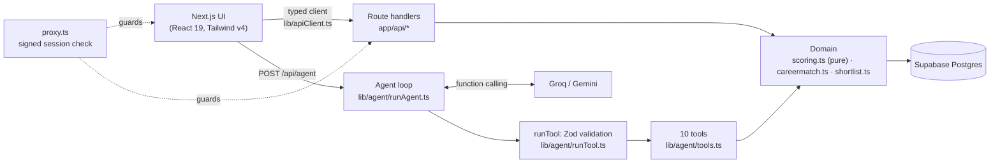

# CareerCraft: AI Job Match Agent

**SRM Agentic AI Hackathon · PS6 Job Match Agent**

CareerCraft is an AI career assistant for final-year students. Instead of scrolling a job board, the student asks in plain English. An LLM agent then calls real tools to check eligibility, score every open job, explain skill gaps, simulate "what if I learn X", and manage an application tracker in Supabase.

- **Live app:** https://careercrafts-two.vercel.app/ (passcode protected)
- **Source:** https://github.com/retro-ayush/CareerCraft

## Team

| Name | Registration no. |
| --- | --- |
| Ayush Kesarwani | RA2411003011931 |
| Aarav Aswal | RA2411026011066 |
| Bhoomi Rajesh Lodha | RA2411026011078 |
| Ashmit Sahu | RA2411026011080 |

## The problem

Students apply to jobs they are not eligible for (CGPA cut-offs and branch rules), miss the roles that fit them, and get no guidance on which skill would open the most doors. For the demo student, Divya K (CSE, CGPA 8.1), only 10 of 50 open roles are strong matches. Without help, she can't tell which 10.

## Features

| Feature | What it does |
| --- | --- |
| **AI career assistant** | Natural-language chat backed by 10 tools. Every tool call is shown in the UI, and calls that write data are labelled. |
| **Explainable match score** | 0-100 = 70% required skills + 20% nice-to-have + 10% preferred city, with a per-job breakdown. |
| **Eligibility rule in code** | CGPA ≥ `min_cgpa`, branch eligible, deadline not passed. Ineligible jobs are refused by the server, never just hidden. |
| **Skill ROI plan** | Ranks missing skills by how many eligible jobs each one would fully unlock and the average score gain. |
| **What-if simulator** | Re-scores every job with a hypothetical skill, without saving anything. |
| **Application tracker** | Drag-and-drop board: saved → applied → interviewing → offer / rejected, with deadlines and AI-written cover notes. |

## Architecture



**Design principles**

- **One source of truth for business rules.** Scoring, eligibility and Skill ROI live in `lib/scoring.ts` as pure functions, and both the agent and the REST API use them. The chat and the pages can never disagree.
- **The model never touches the database.** It can only request tools. `runTool` looks the tool up, validates the arguments with that tool's Zod schema, then runs it. Invalid calls are returned to the model as errors it can fix.
- **Rules are enforced server-side.** The "only eligible jobs can be saved" rule is checked in `lib/shortlist.ts`, not in the prompt or the UI.
- **Typed errors end to end.** Domain code throws `NotFoundError`, `BusinessRuleError` and similar (`lib/errors.ts`). `lib/http.ts` maps them to status codes, hides raw database errors, and logs structured JSON.
- **Provider-agnostic agent.** Groq (OpenAI-compatible) and Gemini share one tool registry, one validation gate and the same loop limits.

### The agent loop

1. The chat history and tool declarations (generated from the Zod schemas) are sent to the model.
2. If the model requests tools, each call is validated and executed, and the results are sent back.
3. This repeats until the model replies in text, or a round limit is reached (protects quota). Groq rate limits and malformed tool calls get bounded retries with timeouts.

| Tool | Purpose | Access |
| --- | --- | --- |
| `getMyProfile` | Student profile, skills, preferences | read |
| `searchJobs` | Filter, apply eligibility, score and rank open jobs | read |
| `scoreJobMatch` | Deep dive into one job: breakdown, gaps, eligibility | read |
| `getSkillGapPlan` | Skill ROI, optionally for a role or city | read |
| `whatIfLearnSkill` | Simulate new skills; nothing saved | read |
| `getMyShortlist` | Saved jobs, statuses, deadlines | read |
| `saveToShortlist` | Save 1-5 jobs; refuses ineligible jobs and duplicates | **write** |
| `updateMySkills` | Add or remove skills; strong matches before and after | **write** |
| `updateApplicationStatus` | Move a shortlisted job through the pipeline | **write** |
| `saveCoverNote` | Save a cover note the agent wrote from real profile facts | **write** |

## Security

- **Sessions:** an httpOnly, SameSite=Lax cookie holding an HMAC-SHA256-signed token with a 12-hour expiry (`lib/auth.ts`). The passcode is never stored in the cookie, comparisons are constant-time, and rotating `APP_PASSCODE` revokes every session.
- **Login throttling:** 10 attempts per IP per 10 minutes (`lib/rateLimit.ts`).
- **Access control:** `proxy.ts` guards every page and API route except login and health.
- **Secrets:** every key is read server-side through `lib/env.ts`. Supabase uses the service key only inside route handlers and tools.
- **Input validation:** every request body, query string and tool argument is validated with Zod.
- **Headers:** `nosniff`, `X-Frame-Options: DENY`, HSTS, Referrer-Policy and Permissions-Policy, and `X-Powered-By` is removed (`next.config.ts`).

## REST API

| Method | Route | Description |
| --- | --- | --- |
| `GET` | `/api/profile` | Current student's profile |
| `PATCH` | `/api/profile` | Update `skills`, `preferred_cities`, `interests` |
| `GET` | `/api/jobs?city=&q=&job_type=&work_mode=` | Open jobs scored for the student, eligible first |
| `GET` | `/api/insights` | Dashboard counts and the Skill ROI plan |
| `GET` · `POST` · `PATCH` · `DELETE` | `/api/shortlist` | List, save (eligibility enforced, `201`), update status or cover note, remove |
| `POST` | `/api/agent` | Run the agent: `{ messages }` → `{ reply, steps }` |
| `POST` | `/api/login` · `/api/logout` | Start or end a session |
| `GET` | `/api/health` | Which settings are configured (never their values) and the active LLM provider |

Errors always come back as `{ "error": string, "details"?: ZodIssue[] }` with a meaningful status (`400`, `401`, `404`, `422`, `429`, `5xx`).

## Project structure

```
app/
  (pages)            /, /jobs, /shortlist, /profile, /settings, /login
  api/*/route.ts     thin route handlers: validate → call domain → respond
components/          AppShell, AgentChat, JobCard, ShortlistPanel, shared UI (ui.tsx)
lib/
  scoring.ts         pure matching logic (score, eligibility, filters, Skill ROI), unit-tested
  careermatch.ts     Supabase reads for profiles and jobs
  shortlist.ts       shortlist / tracker / skills writes with business rules
  agent/             tool registry, Zod gate, Groq + Gemini loops, system prompt
  http.ts errors.ts  route wrapper, typed errors, request validation
  auth.ts rateLimit.ts env.ts logger.ts
  apiClient.ts       typed browser client for the REST API
  constants.ts types.ts schemas.ts   shared domain constants, types, Zod schemas
seed/                Supabase schema and demo data (PS6)
test/                fixtures and test stubs
```

## Quality

| Command | Checks |
| --- | --- |
| `npm run typecheck` | TypeScript strict mode |
| `npm run lint` | ESLint (Next.js core-web-vitals and TypeScript rules) |
| `npm run test` | 71 Vitest unit tests: scoring and eligibility, Skill ROI, dates and time zones, session tokens, rate limiting, HTTP error mapping, and the agent's Zod gate and tool registry |
| `npm run check` | All of the above |

GitHub Actions (`.github/workflows/ci.yml`) runs typecheck, lint, tests and a production build on every push and pull request.

## Run locally

1. `npm install` (Node 20+)
2. In the Supabase SQL Editor, run `seed/ps6_job_match.sql`, then `seed/ps6_careermatch_extras.sql`.
3. Copy `.env.example` to `.env.local` and set `SUPABASE_URL`, `SUPABASE_SECRET_KEY`, `APP_PASSCODE` and either `GROQ_API_KEY` or `GEMINI_API_KEY`.
4. `npm run dev`, then open http://localhost:3000.

**Try:** "Find jobs in Chennai that match my skills and save the top 3" · "What if I learn React?" · "Write a cover note for my best shortlisted job and save it" · edge cases such as "Save job 9999" or "Find jobs on Mars".

## Deployment

The app is deployed on Vercel (`vercel.json` pins the Next.js framework preset). Set the same environment variables in the Vercel project settings. The build itself needs no secrets.

## Tech stack

Next.js 16 (App Router) · React 19 · TypeScript · Tailwind CSS v4 · Supabase (Postgres) · Groq / Gemini function calling · Zod · Vitest · ESLint · Vercel
